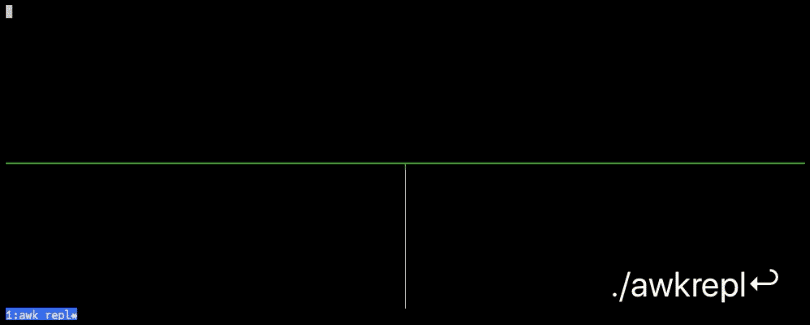

awkrepl
=======



A [REPL][1] of sorts for [AWK][2].

Syntax-checks and pretty-prints your AWK code in the lower right-hand pane when
you save it, and shows the results of your program's execution in the
lower-left. The top pane is your text editor (whatever you have `$EDITOR` set
to, or defaults to `nano`), with the file `~/.repl.awk` open for editing.

Any lines after a `#DATA` line at the end of the program are supplied as input
to your program, for quick testing on sample inputs. The `#DATA` header must be
alone on its line (any case, optionally followed by a colon), so a comment like
`# Database…` or `# data comes from…` is just a comment.

If you have a line in your program (before any `#DATA` line) that starts with
`#ARGS` (or `#ARG`, `#ARGUMENT`, `#ARGUMENTS`, in any case, optionally followed
by a colon), anything on the line after that is passed to `gawk` as
command-line options, _ahead of_ the `-f` for your script, so use it for
options like `-v name=value` or `-F,` (a bare word there is not delivered to
`ARGV`; `gawk` would take it as program text). The header must be followed by
nothing or by options, the first of which starts with `-` (`#ARGS -v x=1`,
`#args: -F,`, `#ARGS:-n`); otherwise, as with `# Args are cool`, the line is
just a comment (and after `#DATA` it's just another line of data). The line is
split with shell-style quoting, so `#ARGS -v "x=a b"` is one `-v` with the
value `x=a b`; globs and `$variables` are not expanded. If a quote is unmatched
(e.g. `#ARGS -v msg=it's`), a warning is printed in the output pane and the
line is split on whitespace instead, with the quote characters kept as typed.

Comment lines (starting with `#`) and blank lines are stripped from your source
before it's run.

`awkrepl` automatically wraps simple programs like `print $1` in `END{…}` (or
in `{…}`, if there's `#DATA`) for you, so it's a piece of cake to try out
little snippets of AWK code.

`gawk` itself decides whether to wrap, by parsing your (comment-stripped)
source both as written and wrapped (with `gawk --pretty-print`, which parses
without running anything):

* if it parses only as written, it's left alone, so rules with actions,
  `BEGIN`/`END` blocks, function definitions, and multi-line programs work
* if it parses only when wrapped (statements like `print $1` or
  `x = 3; print x`), it's wrapped
* if it parses neither way, it's left as written, so the error you see is
  about your own code
* if it parses both ways (a bare expression, which AWK accepts as a pattern
  and as a statement), how it starts decides: something like

  ```awk
  /^r/

  # or
  NF>1

  # or
  !seen[$1]++
  ```

  where the `{print}` is implicit is a pattern and is left alone. That's any
  expression that starts with `{`, `!`, `/`, `(`, `$`, `-`, a number or string,
  or `NR`/`NF`/`FNR`/`FILENAME`, or that contains a comparison or match
  operator (`==`, `!=`, `<`, `>`, `~`) outside a string literal.
  Anything else, starting with a name (an assignment like `x = 3`, a function
  call like `printa(arr)`, `i++`), is taken as a statement and wrapped, so
  `n = split("a b c", arr); printa(arr)` works without `#DATA`.

Requirements
------------

* Docker
* _—or—_ Bash, tmux, [entr][], GNU Awk (as `gawk`), `sed`, and `xargs`
    * also [bat][] (as `bat` or `batcat`), if you want your pretty-printed AWK
      source to also be syntax-highlighted


Usage
-----

If you have all the prereqs and want to run it without Docker, simply make the
`awkrepl` script executable with `chmod a+x` (if it's not already) and put it
somewhere in your search path, like `$HOME/bin`. Run `awkrepl`.

Otherwise, for Docker:

```bash
make build
# or, if you don't have 'make'
docker build -t awkrepl .

make run
# or
docker run -it --rm awkrepl
```

To push your build to your own Docker Hub account (as `<you>/awkrepl`), use
`make publish DOCKER_HUB_USER=<you>`; without `DOCKER_HUB_USER`, `make publish`
stops with a message and pushes nothing.

Or, pull the original author's image straight from Docker Hub, without even
cloning this repo (it's built from the upstream [ernstki/awkrepl][upstream]
repository, so it may not include changes made here):

```bash
docker run -it --rm ernstki/awkrepl
```

The image is based on [debian:stable-slim][slim]; upstream described it as
about ~65 MB compressed.

The [`examples.awk`](examples.awk) from this repository is copied to
`~/.repl.awk` in the Docker container, to provide you with some working
examples to play with. Just clear out the entire contents of this file and
replace with your own code when you get bored with those examples.

### Using a different editor with the Docker container

The `make run` target shown above will respect the `EDITOR` environment
variable from your current login session, defaulting to `nano` if it's not set.
You can specify a different editor like this:

```
make run EDITOR=vim

# or
docker run -it -e EDITOR=vim --rm awkrepl
```

There's no GNU Emacs in the Docker image to keep the size down, but there's
[jove][], which installs itself as `emacs`, and that'll do in a pinch (`vim`,
`nano`, and `jed` are installed too).  You
could always modify the Dockerfile and `make build`!

It's also possible to run straight from [Docker Hub][hub], if that's your
thing:

```bash
docker run -it -e EDITOR=emacs --rm ernstki/awkrepl
```


Bugs
----

The whole script _probably_ should've just been written in Perl.

Please [report any issues][issues] you find, though.


See also
--------

* <https://en.wikipedia.org/wiki/AWK>
* <https://en.wikipedia.org/wiki/Read%E2%80%93eval%E2%80%93print_loop>
* <https://www.grymoire.com/Unix/Awk.html>


Author
------

Kevin Ernst ([ernstki -at- mail.uc.edu](mailto:ernstki%20-at%20mail.uc.edu))


License
-------

MIT.


[1]: https://en.wikipedia.org/wiki/Read%E2%80%93eval%E2%80%93print_loop
[2]: https://en.wikipedia.org/wiki/AWK
[entr]: http://eradman.com/entrproject/
[bat]: https://github.com/sharkdp/bat
[jove]: https://www.emacswiki.org/emacs/Jove
[slim]: https://hub.docker.com/_/debian
[hub]: https://hub.docker.com/repository/docker/ernstki/awkrepl
[issues]: https://github.com/That-Guy-40/repl-acement/issues
[upstream]: https://github.com/ernstki/awkrepl
